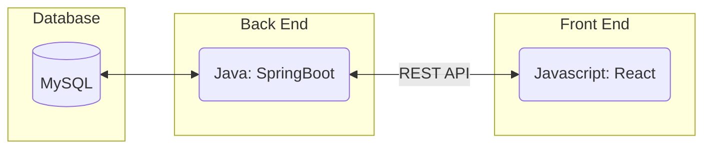
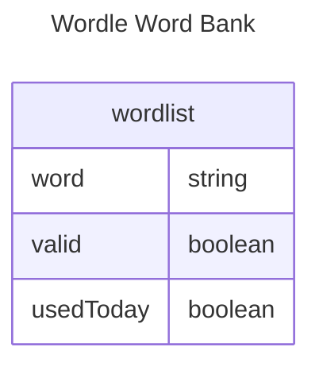
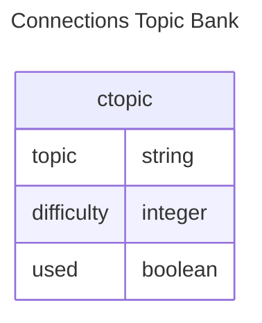
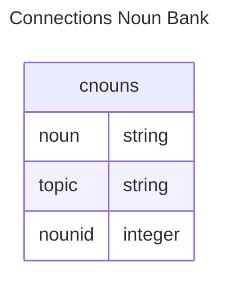
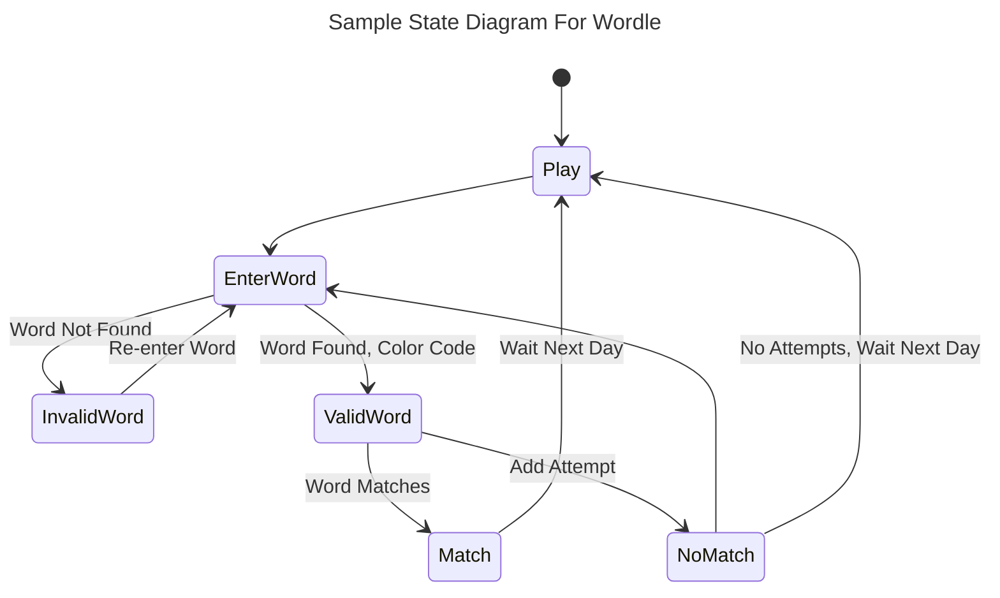
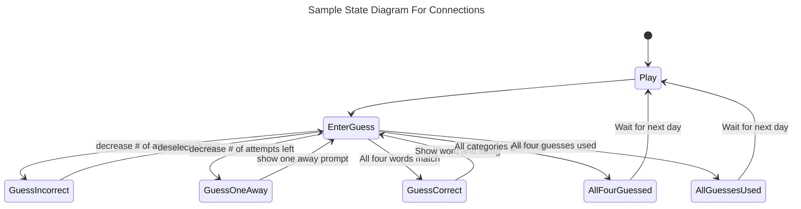
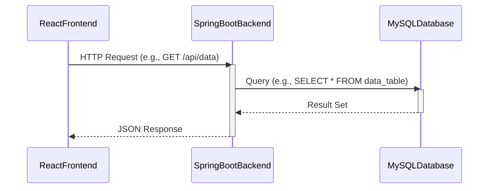

# Specification Document
<!--Please fill out this document to reflect your team's project. This is a living
document and will need to be updated regularly. You may also remove any section to
its own document (e.g. a separate standards and conventions document), however you
must keep the header and provide a link to that other document under the header.
Also, be sure to check out the Wiki for information on how to maintain your team's
requirements.-->
## NY Times Copycats
<!--The name of your team.-->
### Project Abstract
<!--A one paragraph summary of what the software will do.-->
This is a website hosting a recreation of the "Wordle" and "Connections" games from The New York Times Games websites : https://www.nytimes.com/games/wordle/index.html and https://www.nytimes.com/games/connections

### Wordle
The game presents a challenge to guess a five-letter word. The user can type or click on an on-screen keyboard to enter a real, non-proper noun, five-letter word. The game then responds by Highlighting any letters present in the solution word:
- YELLOW for a letter that exists in the solution, at a different position.
- GREEN for a letter that exists in the solution, at its current position. 
- BLACK for a letter that does not exist in the solution.
If the word does not exist in the database, the user will be asked to retry without using an attempt.
Letters not present in the solution at all are not highlighted and are then blacked out on the on-screen keyboard.
The player then enters new words below previous guesses and similar feedback repeats until all letters are GREEN (Win. Solution found) or until six words have been entered (Loose. Solution not found). The correct solution is revealed when the player looses.
Challenges refresh daily with a single global new word served to all players, regardless of a player's completion of past challenges.

### Connections
This game is presented by a 4x4 board, each with a specifc word. The user can click on these words, until there are four words that are selected. The purpose of the game is to select four words that are related by a category. These four categories are increasing difficulty, with the connections between the words becoming increasingly abstract. The following are the responses to a guess:
- INCORRECT for a guess where there are two or less words that are in the same category
- ONE AWAY for a guess that has exactly three words in a category, but the fourth is INCORRECT
- CORRECT for a guess that has all four words that relate to a category 
If a guess is incorrect, it will deselect all of the selected words. If a guess is one away, all of the words are selected, but a prompt shows up that shows "ONE AWAY". If all of the correct letters are guessed, they will come together as a group on the top of the screen that shows their string connection. They are then colored in difficulty as per the following:
- YELLOW easiest category
- GREEN second easiest category
- BLUE second hardest category
- PURPLE hardest category

### Customer
<!--A brief description of the customer for this software, both in general (the
population who might eventually use such a system) and specifically for this
document (the customer(s) who informed this document). Every project will have a
customer from the CS506 instructional staff. Requirements should not be derived
simply from discussion among team members. Ideally your customer should not only
talk to you about requirements but also be excited later in the semester to use the
system.-->
This is simple web game designed to be revisited daily and played only in short sessions. It is meant for people interested in simple, accessible, and mentally stimulating games and could serve as an alternative to the original NYT version with additional features, as scope changes.

Grayson Elias is the appointed "customer" from CS506 staff. 
### Specification
<!--A detailed specification of the system. UML, or other diagrams, such as finite
automata, or other appropriate specification formalisms, are encouraged over
natural language.-->
<!--Include sections, for example, illustrating the database architecture (with,
for example, an ERD).-->
<!--Included below are some sample diagrams, including some example tech stack
diagrams.-->
#### Technology Stack

#### Database

### Wordle
The Database employs a single table containing all valid five letter-words (primary key). This table is referenced both for picking a daily word and for checking validity of user input. The table distinguishes words that are valid for the daily Wordle (boolean) and keeps track of whether a word has been picked for a daily Wordle before (boolean).

### Connections
The Database employs two tables: One table has a topic that will be used to select strings in the same topic, along with a difficulty integer and a nounid integer (primary key). The other table has the noun that is the word, and the topic that is assocated with that word.  

#### Behavior

### Wordle

### Connections

#### Sequence Diagram

### Standards & Conventions
<!--This is a link to a seperate coding conventions document / style guide-->
[Style Guide & Conventions](STYLE.md)
