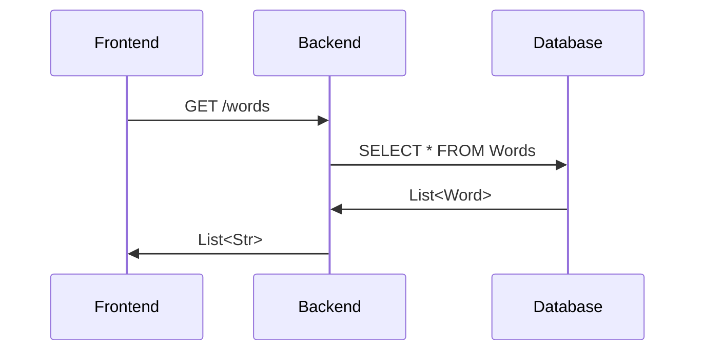

# Walking Skeleton for NYT game webapp

In this document, we will create a walking skeleton for this project, which will outline the most basic core functions that our webapp will have to be fully integrated between frontend, backend, and database.

In a nutshell, it should be something like a Minimal Viable Project (MVP) but even lighter, so that just the very basic core features of the webapp works integrated.

Please click [here](https://fibery.io/blog/product-management/walking-skeleton) for more info on walking skeletons.


## Core functionalities

As mentioned above, we will need to have core functionalities for 3 parts:

1. Database
2. Frontend
3. Backend

The way this will be integrated is that the database will store relevant information for the game (e.g. If game is Wordle, maybe a list of English words). The frontend will need to access this information, which will happen through the backend.

We will dive into more detail regarding core features below.

### 1. Database

The very core feature of the database for this project would be to have a single table that serves strings.

Our table should be at the very minimum like this:
| Column name | Type | Description |
|--|--| -- |
| word | VARCHAR(5) | Primary key. Stores a 5 character string|

This table the "word" itself works as a PK because there will not be any repeated 5 letter word.

We will eventually populate a dictionary (e.g. Oxford, Cambridge, etc.) to populate, but for now a single word entry is sufficient.

### 2. Frontend

The frontend will host most of the logic for running the game, such as input validation, verifying win conditions for whatever game being played (e.g. In Wordle we would verify how many characters are green or yellow).

However, for the purpose of this document, we only want to fetch a word and log it to the console, ensuring us we can communicate with the database.

Some code for this could be:
```jsx
// ...inside App.js
function fetchWordsFromDb() {
	// Logic for calling backend API
}

function App() {
	const words = fetchWordsFromDb()
	console.log(words)
	return (...)
}
// ...
```

### 3. Backend

The backend will simply serve the information stored in the backend to the frontend.

It should host an API with a single endpoint that returns all of the words in the database.

For us to do this, we will need to create a `WordRepository` to connect the backend to our database table, then host an endpoint that looks like the code below:

```java
// ...inside word controller class

@RestController  
class WordController{
	private final WordRepository repository; 

	WordController(WordRepository repository {
		this.repository = repository; 
	}
	 
	 @GetMapping("/words") 
	 List<Word> all() { 
		 return repository.findAll();
	 }
	 
	 // ...
}
```

This will allow us to return all of the `Word` inside our database table with ease.


## Skeleton diagram

Putting all of the three steps above together, we will have our walking skeleton done. Their interaction will follow this simple diagram:
